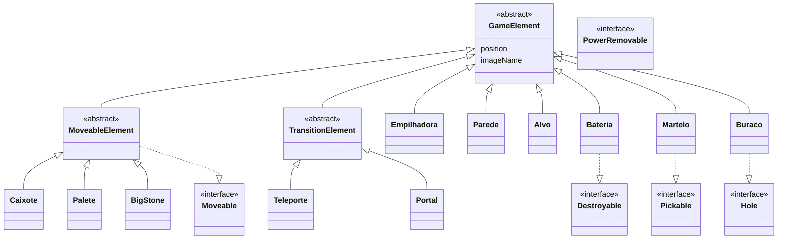

# 📦 Sokoban — Empilhadora

> Projeto de **Programação Orientada a Objetos** · ISCTE-IUL

Versão do clássico **Sokoban** em Java: controlas uma empilhadora num armazém e tens de empurrar todos os caixotes para os alvos, antes de ficares sem energia. Inclui ferramentas, teleportes, buracos e paredes que se partem, ao longo de **8 níveis**.


<p align="center">
  
  
  
  
  
  
</p>

---

## 🎮 Como jogar

| Tecla | Ação |
|---|---|
| ⬅️ ⬆️ ➡️ ⬇️ | Mover a empilhadora |
| `Espaço` | Recomeçar o nível |

**Regras**
- 🔋 Começas com **100 de energia**; cada movimento gasta 1, e empurrar objetos gasta mais
- 🔌 Apanhar uma **bateria** dá **+50 de energia**
- 🔨 Com o **martelo** ou a **picareta** consegues partir **paredes rachadas** e **pedras pequenas**
- 🌀 Os **teleportes** ligam-se aos pares e transportam-te para o outro lado
- 🕳️ Cair num **buraco**, ou ficar sem energia, é **game over**
- 🏆 A pontuação é o número de movimentos, e o **top 3** de cada nível fica guardado em `Pontuacoes/`

---

## 🗺️ Formato dos níveis

Os níveis são ficheiros de texto 10×10 em [`levels/`](levels), por isso é fácil criar novos:

| Símbolo | Elemento | Símbolo | Elemento |
|---|---|---|---|
| `E` | Empilhadora (jogador) | `B` | Bateria |
| `#` | Parede | `%` | Parede rachada |
| `C` | Caixote | `M` | Martelo |
| `X` | Alvo | `p` | Picareta |
| `P` | Palete | `S` | Pedra grande |
| `O` | Buraco | `s` | Pedra pequena |
| `T` | Teleporte (aos pares) | `=` | Vazio |
| ` ` | Chão | | |

```
=########=
##XC  CC##
#XC   CC #
#CCS CC  #
#CC   C C#
#OC s  C #
# CC  C C#
#C CC  CC#
##M    E##
=########=
```
*`level0.txt`*

---

## 🧱 Arquitetura OO

O design assenta numa hierarquia de classes abstratas e em **interfaces de comportamento**, para que cada elemento declare o que consegue fazer em vez de o motor ter `if`s por tipo.



| Padrão / conceito | Onde |
|---|---|
| **Singleton** | `GameEngine.getInstance()` |
| **Observer** | `GameEngine` observa o teclado através da GUI |
| **Polimorfismo por interfaces** | `Moveable`, `Pickable`, `PowerRemovable`, `Hole`, `Transition`… |
| **Persistência em ficheiro** | `Pontuacao` lê/escreve o ranking por nível |

---

## 🚀 Como correr

O projeto usa a biblioteca gráfica fornecida pela cadeira (`pt.iscte.poo.gui`), por isso a forma mais simples é abri-lo no **Eclipse** com essa biblioteca no classpath e correr:

```
src/pt/iscte/poo/sokobanstarter/Main.java
```

---

## 📂 Estrutura

```
├── src/pt/iscte/poo/sokobanstarter/   # código do jogo
├── levels/                            # level0.txt … level7.txt
├── images/                            # sprites
├── Pontuacoes/                        # top 3 por nível
└── Relatorio_*.docx                   # relatório do projeto
```

---

## 👥 Autores

- **André Pita** · 111652
- **Guilherme Pereira** · 110909
